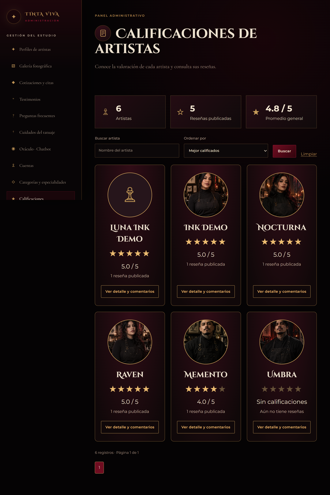
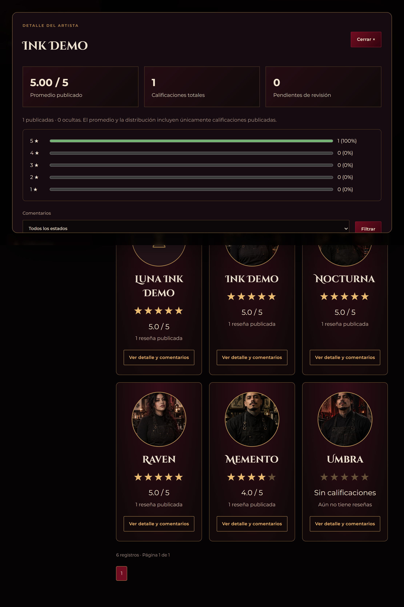
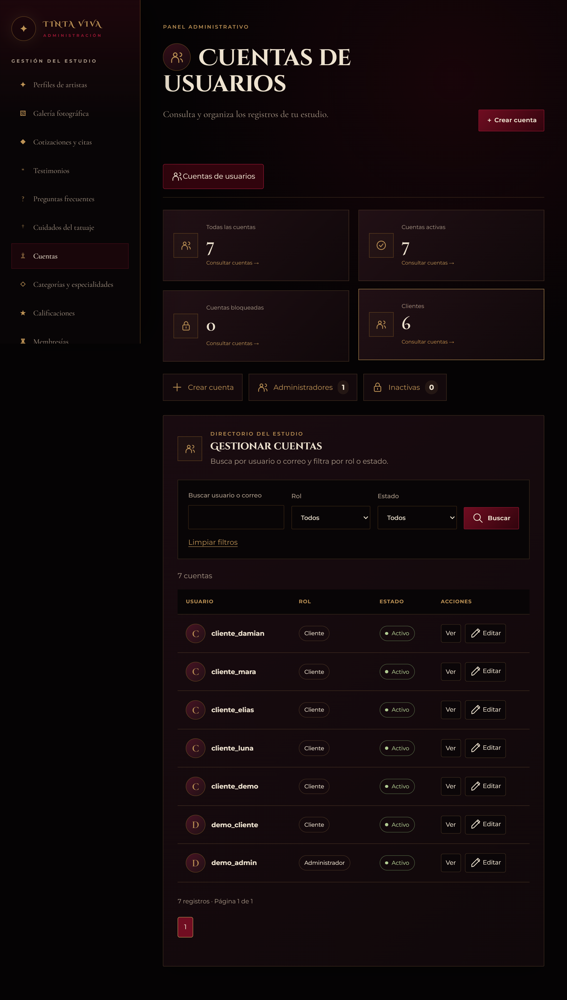
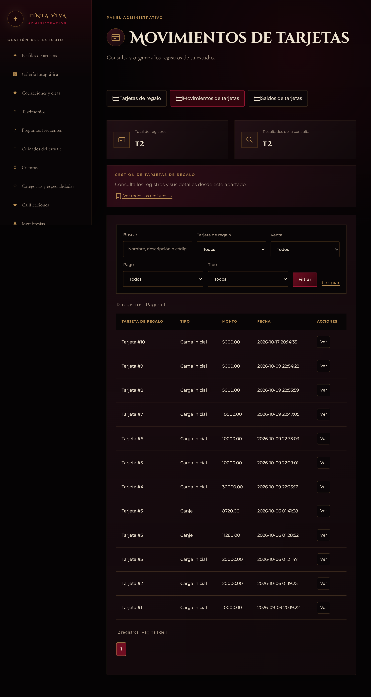
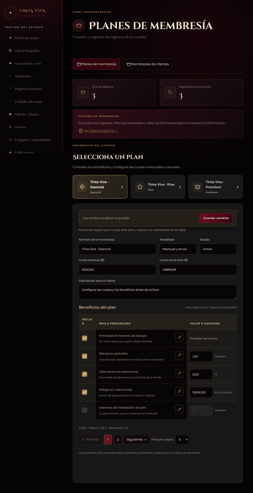
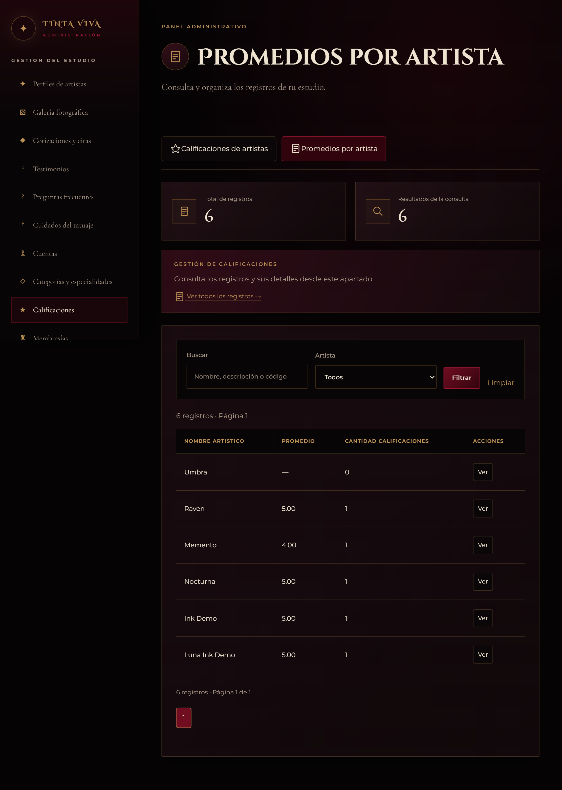
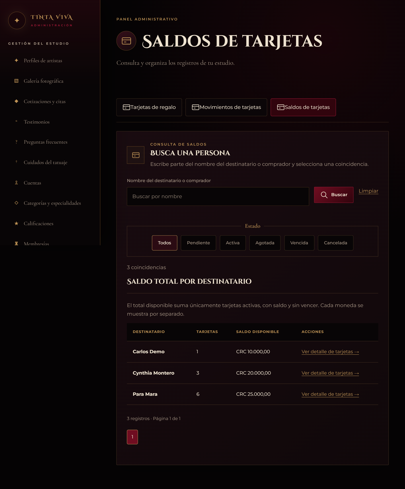
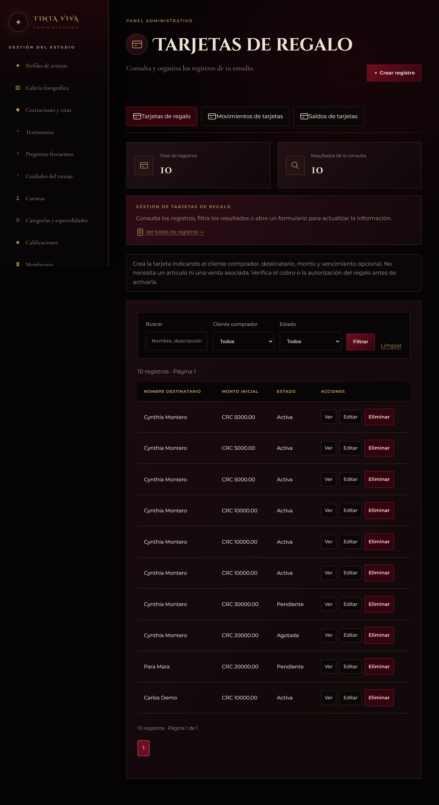

# Galería de pantallas · Tinta Viva

[← Volver al README](../README.md)

Capturas proporcionadas para la documentación de Persona 2. Se conservan las versiones alternativas para mostrar la evolución visual. La rama Cynthia integra los avances de main, incluidas las calificaciones por artista. Los datos reflejan el momento de cada captura.

## administrador

<strong>Calificaciones con tarjetas por artista</strong>

<strong>Detalle del artista y distribución de estrellas</strong>

<strong>Categorías de artículos</strong>

<strong>Cuentas · versión anterior</strong>

<strong>Directorio de cuentas e indicadores</strong>

<strong>Movimientos de tarjetas de regalo</strong>

<strong>Planes de membresía y beneficios</strong>

<strong>Productos filtrados por categoría</strong>

<strong>Productos e inventario</strong>

<strong>Promedios por artista · versión anterior</strong>

<strong>Saldos de tarjetas de regalo</strong>

<strong>Tarjetas de regalo</strong>

<strong>Ventas de la tienda</strong>

## cliente

<strong>Confirmación de membresía</strong>

<strong>Membresía activa y beneficios</strong>

<strong>Tarjetas de regalo · vista alternativa</strong>

<strong>Tarjetas de regalo</strong>

<strong>Tienda, filtros, ofertas y artículos</strong>

